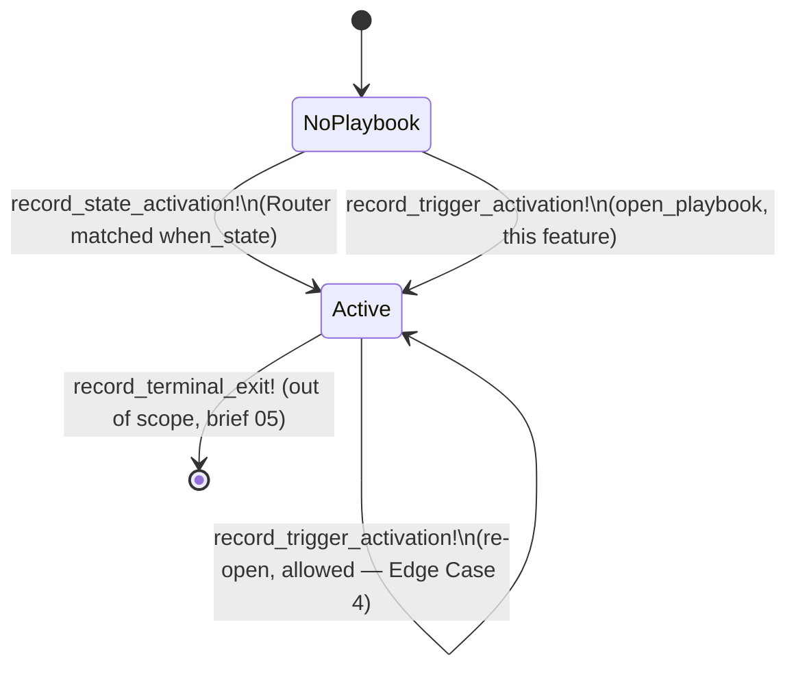

# Phase 1 Data Model: Scout V2 Typed Instructions, Playbook Index, and Mid-Turn Playbook Activation

## 1. `Scout` (existing model, `ichatr_scouts` table) — new columns

| Column | Type | Null | Default | Notes |
|---|---|---|---|---|
| `tone` | `integer` | `false` | `0` | Rails enum, backs `Scout#tone` |
| `response_length` | `integer` | `false` | `0` | Rails enum, backs `Scout#response_length` |
| `greeting` | `text` | `true` | `nil` | Free-form; blank ⇒ Communication builder emits a generic greeting directive instead of quoting one |

**Migration** (additive only, no existing column touched — Constitution Principle I/IV):
`db/migrate/21260925000000_add_communication_style_to_ichatr_scouts.rb`, `add_column` × 3,
reversible via the implicit `change` inverse.

**Rails enum declarations** (mirrors the existing `ScoutConversationState#activation_reason`
pattern already in the tree):

```ruby
enum :tone, { friendly: 0, neutral: 1, matter_of_fact: 2, professional: 3, humorous: 4 },
     default: :friendly, scopes: false
enum :response_length, { concise: 0, standard: 1, thorough: 2 },
     default: :concise, scopes: false
```

**Validation rule**: Rails' generated enum writer raises `ArgumentError` for any value outside the
declared mapping — this is what "reject any value outside its set" (FR-003) means at the model
layer; no additional DB `CHECK` constraint is introduced (no existing enum column in this table
has one either).

**Relationships**: none new — `tone`/`response_length`/`greeting` are scalar attributes, read by
`Custom::ScoutV2::Instructions::CommunicationBuilder`, nothing else.

## 2. `Custom::ScoutV2::Playbook` (existing `Data.define`, unchanged shape)

No new fields. `IndexBuilder` and `OpenPlaybook` read only fields the struct already exposes:
`name`, `trigger`, `body`, `tools`. `requires`/`exits` continue to be carried on the struct,
unread by any new code in this phase (see `research.md` §2) — they are consumed, unchanged, by the
same telemetry computation (`unmet_requires`) that already exists for the state-activated path.

## 3. `ScoutConversationState` (existing model, `ichatr_scout_conversation_states` table)

No schema change — `activation_reason` already has a `trigger` value (`enum :activation_reason,
{ state: 0, trigger: 1, transition: 2 }`, added ahead of this feature by Brief 03). New instance
method:

```ruby
def record_trigger_activation!(playbook_name)
  update!(active_playbook: playbook_name, activated_at: Time.current, activation_reason: :trigger)
  self
end
```

Mirrors the existing `record_state_activation!` exactly, differing only in the persisted
`activation_reason`. This is the write path `Custom::ScoutV2::Tools::OpenPlaybook#execute` calls
on success — the concrete mechanism behind FR-015.

**State transitions relevant to this feature** (no new states, one new edge):



`activation_reason` on the `Active` state distinguishes which edge was taken; `Router` treats both
identically for continuity purposes (design.md §4.4, decision already shipped, unchanged here).

## 4. New in-memory value objects (no persistence)

| Type | Owner | Shape | Purpose |
|---|---|---|---|
| Instructions block (`String`) | `Custom::ScoutV2::Instructions::Builder` | `"[Identity]\n...\n\n[Communication]\n...\n\n[Memory]\n...\n\n[Safety]\n..."` | The always-on, four-section, typed-config-driven block (FR-001–FR-008) |
| Playbook index block (`String`) | `Custom::ScoutV2::Playbook::IndexBuilder` | `"[Playbook Index]\n- name: trigger\n..."` (or the empty-catalog line) | The always-on, one-line-per-playbook signal (FR-009, FR-010, FR-018) |
| Tool result (`Hash`) | `Custom::ScoutV2::Tools::OpenPlaybook#execute` | `{ body: String }` on success, `{ error: String }` on unknown name | The direct-outcome channel FR-013/FR-016 require |

None of these are ActiveRecord-backed; they exist only for the duration of one `TurnRunner#perform`
call, exactly like the pre-existing `Custom::ScoutV2::RoutingSnapshot` and `Router::Decision`
value objects they sit alongside.

## 5. Validation summary (delta only — everything else in the v2 engine is untouched)

| Rule | Enforced by | FR |
|---|---|---|
| `tone` ∈ 5 named values, default `friendly` | Rails enum on `Scout` | FR-003 |
| `response_length` ∈ 3 named values, default `concise` | Rails enum on `Scout` | FR-003 |
| Instructions block has exactly 4 sections, fixed order | `Instructions::Builder` composes a fixed, non-configurable list of 4 builder calls — no data-driven section count | FR-001 |
| Playbook index block always present, even when empty | `IndexBuilder` always emits the header line, never returns a blank string | FR-018, SC-007 |
| `open_playbook` only offered when no playbook is forced by state | `TurnRunner#build_tools` gates the tool's registration on `playbook.blank?` | FR-011, FR-012 |
| Unknown playbook name → tool-level error, turn continues | `OpenPlaybook#execute` returns `{ error: ... }`, never raises | FR-016 |
