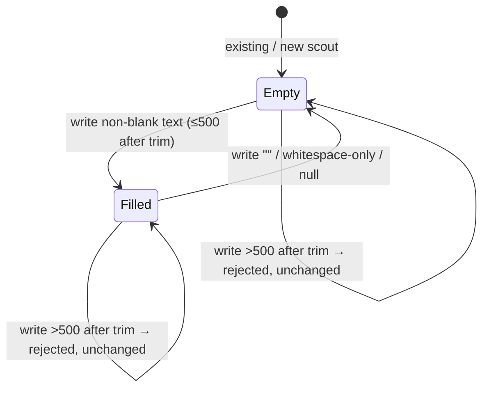

# Data Model: Scout V2 Identity and Style Settings

## 1. `Scout` (`ichatr_scouts`, fork-owned table) — two new columns

| Column | Type | Null | Default | Notes |
|---|---|---|---|---|
| `role` | `text` | yes | `nil` | NEW. What the assistant is for (purpose, business, audience). V2 Identity only. |
| `scope` | `text` | yes | `nil` | NEW. What the assistant may / may not talk about. V2 Identity only. |

Existing columns this feature exposes but does not alter:

| Column | Type | Null | Default | Notes |
|---|---|---|---|---|
| `tone` | `integer` (enum) | no | `0` (`friendly`) | `friendly` · `neutral` · `matter_of_fact` · `professional` · `humorous` |
| `response_length` | `integer` (enum) | no | `0` (`concise`) | `concise` · `standard` · `thorough` |
| `greeting` | `text` | yes | `nil` | Free text; no new length limit. Squished to one line at render (unchanged). The screen sends `null` when empty. |
| `persona` (alias `system_prompt`) | `text` | yes | `nil` | V1 only. Not read by V2, not copied, not changed. |

**Migration** (additive, reversible, fork-owned table only — Constitution I/IV):
`db/migrate/21260927000000_add_role_and_scope_to_ichatr_scouts.rb` → `add_column :ichatr_scouts,
:role, :text` and `add_column :ichatr_scouts, :scope, :text`. No backfill.

### Validation and normalization rules

| Rule | Where | Requirement |
|---|---|---|
| `role`, `scope`: strip leading/trailing whitespace and line breaks; `nil` when nothing remains; internal characters (incl. line breaks) untouched | `normalizes :role, :scope, with: ->(v) { v.strip.presence }` on `Scout` | FR-001, FR-011, clarification 5 |
| `role`, `scope`: length ≤ 500 characters, measured on the normalized value; `nil` allowed | `validates :role, :scope, length: { maximum: 500 }` on `Scout` | FR-001, FR-011 |
| `tone` ∈ documented names, as a String | Controller `before_action` (request boundary), `Scout.tones.key?(value)` | FR-010 |
| `response_length` ∈ documented names, as a String | Controller `before_action`, `Scout.response_lengths.key?(value)` | FR-010 |
| `tone` / `response_length` non-null | Existing DB `NOT NULL` + enum default (unchanged) | Edge case "never touched" |

Enum declarations stay exactly as they are (no `validate: true`, see research §1).

### State behavior (per field, per write)

`Empty` (`nil`) ⇒ Identity uses that field's Default Identity statement(s); `Filled` ⇒ Identity uses
the stored text. Brief 10's preflight reads the same `nil`/non-`nil` distinction (not built here).

## 2. Identity section (derived, not stored)

Built by `Custom::ScoutV2::Instructions::IdentityBuilder` from `scout.name`, `scout.account.name`,
`scout.role`, `scout.scope`. Three slots, header `[Identity]`, lines joined with `"\n"`:

| Slot | Source when field empty | Source when field filled |
|---|---|---|
| intro | Default intro (with "assistente inteligente de qualificação comercial e vendas") | Neutral intro "Você é {name}, assistente da empresa {account}." (Role filled) |
| purpose | Default purpose statement | `role` verbatim |
| scope | Default scope statement | `scope` verbatim |

Intro + purpose both depend on Role; scope slot depends only on Scope. Exact strings:
[contracts/identity_section.md](./contracts/identity_section.md).

## 3. Communication section (derived, unchanged)

`Custom::ScoutV2::Instructions::CommunicationBuilder` — no code change. It already maps `tone` /
`response_length` to fixed sentences and quotes `greeting.squish`; this feature only makes those
values writable through the API/screen.

## 4. Relationships

None new. `role`/`scope` are scalar attributes read only by `IdentityBuilder`. V1
(`Custom::Scout::SystemPromptsService`) reads none of `role`, `scope`, `tone`, `response_length`,
`greeting`.
