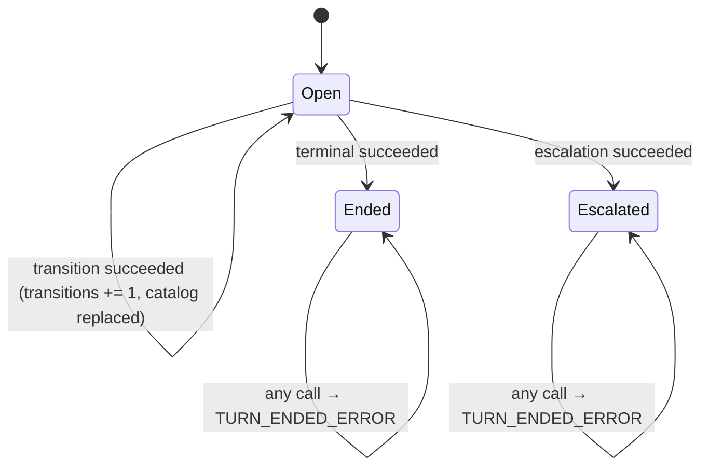

# Data Model: Scout V2 Escalation Layer, Declared Exits, and an Auditor-Free Turn

No migration. Every persisted field below already exists; this feature adds two in-memory value
types, one per-turn runtime object, and the rules that write the existing columns.

## ExitDeclaration (new value — `Custom::ScoutV2::Playbook::ExitDeclaration`)

`Data.define(:name, :kind, :fields, :target, :stage)`, built by `Playbook::Loader` from one entry of
a playbook's `exits:` mapping and held in `Playbook#exits` (`Hash{String name => ExitDeclaration}`,
insertion order = file order). Syntax: [contracts/playbook_exit_declaration.md](./contracts/playbook_exit_declaration.md).

| Field | Type | Rule (validated at boot, FR-006) |
|---|---|---|
| `name` | String | the mapping key; `Validator::NAME_PATTERN` (`/\A[a-z][a-z0-9_]*\z/`); not `handoff` |
| `kind` | String | one of `terminal`, `transition`, `escalation` (`KINDS`) |
| `fields` | `Hash{String => String}`, ordered | keys match `NAME_PATTERN`; values in `FIELD_TYPES` = `string integer number boolean datetime`; `{}` when omitted |
| `target` | String or nil | required iff `kind == 'transition'`; must name a catalog playbook that is not the declaring one and has a non-empty `when_state` (a procedure) |
| `stage` | String or nil | nil or one of `STAGE_ROLES` = `qualified unqualified` |

Playbook-level rule: a playbook with empty `when_state` (situational) declares no exits.

**Built-in**: `ExitDeclaration::HANDOFF` = `name: 'handoff', kind: 'escalation',
fields: { 'reason' => 'string' }, target: nil, stage: nil`. Offered on every v2 turn as
`exit_handoff`; never read from a file; its name is reserved.

Supplied field values are never persisted as data: they reach `recorded_tool_calls` (FR-024) and,
for escalation only, the transfer note (FR-009).

## TurnScope (new per-turn runtime object — `Custom::ScoutV2::TurnScope`)

Created by `TurnRunner` for one `chat.ask`; discarded at the end of the turn. Never persisted.

| Member | Meaning |
|---|---|
| `chat` | the live `RubyLLM::Chat` |
| `catalog` | the turn's loaded `Playbook::Catalog` (transition target lookup) |
| `baseline_instructions` | Identity/Communication/Memory/Safety + Playbook Index + Escalation (no playbook body) |
| `baseline_tools` | wrapped instances: `search_knowledge_base`, `exit_handoff`, `open_playbook` (when the openable set is non-empty) |
| `playground` | true on the playground surface (escalation skips care check and transfer) |
| `ended?` | a terminal or escalation exit succeeded this turn — every later tool/exit call returns `TURN_ENDED_ERROR` (FR-015) |
| `escalated?` | an escalation exit succeeded this turn (empty-reply rule, FR-012) |
| `transitions` | successful transitions this turn, starts at 0 (FR-011 limit of 2) |
| `procedure_in_turn?` | a procedure was pinned at turn start, opened mid-turn, or became a transition target — further procedure opens are refused (FR-007) |

State machine (per turn):

## Persisted state written by exits (existing columns)

### `ichatr_scout_conversation_states` (`ScoutConversationState`, Brief 02 operations reused unchanged)

| Outcome | Operation | `active_playbook` | `activated_at` | `activation_reason` | `last_exit` | `transition_count` | `handoff_limit_reached_at` |
|---|---|---|---|---|---|---|---|
| terminal | `record_terminal_exit!(name)` | nil | nil | nil | `name` | — | — |
| escalation (built-in / declared) | `record_terminal_exit!(name)` | nil | nil | nil | `handoff` / `name` | — | — |
| transition (≤ 2nd this turn) | `record_transition!(target, turn_transition_count:)` → true | `target` | now | `transition` | — | +1 | — |
| transition (3rd this turn) | `record_transition!` → false | — | — | — | — | — | now |
| invalid / refused / stage-failed exit, no exit, fail-safe | none | — | — | — | — | — | — |

"—" = unchanged. Escalation writes only when the transfer is performed (inbox) or, in the
playground, when the exit succeeds.

### `opportunities.pipeline_stage_id` (via `OpportunityStageTransitionService`)

Written only by an exit that declares `stage`, on `conversation.active_opportunity`, to
`scout.qualified_stage_id` / `scout.unqualified_stage_id`, after the service's checks pass
(qualification requirements for the qualified stage; forward-move stage requirements). Rolled back
with the rest of the exit's writes on any later failure in the same transaction.

### `conversations` + `messages` (escalation on the inbox, via `HandoffService#transfer!`)

| Column / record | Change |
|---|---|
| `conversations.team_id` | `scout.handover_team_id` when present |
| `conversations.status` | `pending` → `open` (`bot_handoff!`), `ai_assignee` cleared, `waiting_since` set if blank |
| private message | one transfer note: `📋 Transferência para atendimento humano: <reason>[ \| Oportunidade #<id> - <title>]` |
| public message | none written by the exit; the turn's final reply (or the standard handoff message) is posted afterwards by `ProcessMessageJob` |

Precondition, checked under `conversation.with_lock`: `status == pending`. Otherwise no row above
changes.

## Validation rules summary

| Rule | Where | Requirement |
|---|---|---|
| Exit entry shape (mapping, `fields` mapping, known keys) | `Playbook::Loader` → `load_errors` | FR-005, FR-006 |
| Kind / target / type / field name / stage role / reserved name / situational | `Playbook::Validator` | FR-006 |
| Payload present / declared / typed | `Exits::PayloadValidator` | FR-004, FR-008 |
| Opportunity present, stage role configured, stage requirements | `Exits::StageMove` (+ `OpportunityStageTransitionService`) | FR-014 |
| Conversation still `pending` | `Exits::Escalation` (inbox) | FR-022 |
| ≤ 2 transitions per turn | `Exits::Transition` + `record_transition!` | FR-011 |
| No action after a turn-ending exit | `TurnScope` guard | FR-015 |
| At most one procedure per turn | `OpenPlaybook` + `TurnScope#procedure_in_turn?` | FR-007 |
