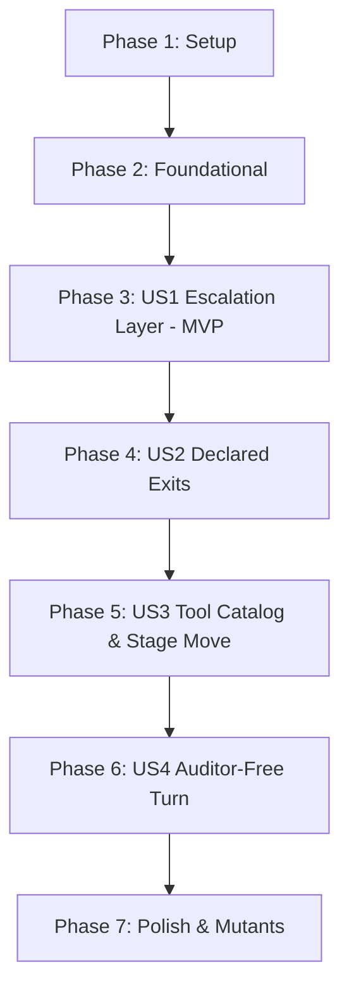

# Tasks: Scout V2 Escalation Layer, Declared Exits, and an Auditor-Free Turn

**Input**: Design documents from `/specs/087-scout-v2-exits-escalation/`
**Prerequisites**: `plan.md`, `spec.md`, `data-model.md`, `contracts/`, `research.md`, `quickstart.md`
**Tests**: Included per Constitution Principles VI (TDD) and VII (Observable Behavior). In every phase the test tasks come first and MUST be observed failing for the right reason before the implementation tasks that follow them start. Tasks labeled **contract change** update existing assertions whose contract this feature changes; they are not red-first evidence of new behavior.
**Organization**: Setup, Foundational (declarations + a no-behavior-change `TurnScope` refactor), then user stories US1–US4 in priority order, then Polish.

---

## Format: `- [ ] [TaskID] [P?] [Story?] Description with file path`

- **[P]**: Can run in parallel (different files, no dependencies on incomplete tasks)
- **[Story]**: User story identifier (`[US1]`, `[US2]`, `[US3]`, `[US4]`) — omitted for Setup, Foundational, and Polish
- Every test and implementation task names its exact file(s); verification tasks name the exact command and spec list (quickstart section)
- Acceptance tests use the real entry points only — playground `POST /api/v1/accounts/:id/scouts/:scout_id/playground_messages` and inbox `described_class.new.perform(conversation.id)` — with WebMock on the Gemini `generateContent` endpoint as the only double. Fixture catalogs are written inline with `Dir.mktmpdir` + `with_modified_env SCOUT_V2_PLAYBOOKS_DIR:` (existing pattern), using the `fluxo_teste` example from `contracts/playbook_exit_declaration.md` plus an `outro_procedimento` target procedure and one situational playbook.

---

## Phase 1: Setup

**Purpose**: Confirm a green starting point for every file this feature touches.

- [X] T001 Run the pre-change baseline with the quickstart §1 and §2 spec lists (`custom/spec/services/custom/scout_v2/playbook/{loader,validator}_spec.rb`, `custom/spec/services/custom/scout_v2/tools/`, `custom/spec/services/custom/scout_v2/turn_runner_spec.rb`, `custom/spec/requests/api/v1/accounts/scouts/playground_messages_controller_spec.rb`, `custom/spec/jobs/custom/scout/process_message_job_spec.rb`, and the seven v1 files of quickstart §2); all green before any edit

---

## Phase 2: Foundational (Blocking Prerequisites)

**Purpose**: Exit declarations validated at boot, and the per-turn `TurnScope` introduced as a pure refactor on a green suite.

**⚠️ CRITICAL**: No user story work can begin until this phase is complete.

### Tests (write first, observe failing)

- [X] T002 [P] Loader specs in custom/spec/services/custom/scout_v2/playbook/loader_spec.rb: new `exits:` shape normalized to ordered `ExitDeclaration` values (kind, fields in file order, target, stage); shape errors recorded on `load_errors` — exit entry not a mapping, `fields` not a mapping, unknown key in an exit entry (FR-006). Contract change: the flat-shape example (`agendado: { opportunity_id: integer, … }`) moves to the new shape
- [X] T003 [P] Validator specs in custom/spec/services/custom/scout_v2/playbook/validator_spec.rb: one `ValidationError` listing every FR-006 violation in one pass (unknown kind, transition without/unknown/self/situational target, target on a non-transition exit, unsupported field type, invalid field name, unknown stage role, exit named `handoff`, situational playbook declaring exits) (SC-007); a body referencing `exit_handoff` with no declaration is valid. Contract change: flat `exits:` Hash literals move to `ExitDeclaration` values

### Implementation

- [X] T004 Implement `Custom::ScoutV2::Playbook::ExitDeclaration` (`Data` + `KINDS`, `FIELD_TYPES`, `STAGE_ROLES`, `HANDOFF`) in custom/app/services/custom/scout_v2/playbook/exit_declaration.rb
- [X] T005 Normalize exits into `ExitDeclaration` and record shape errors in custom/app/services/custom/scout_v2/playbook/loader.rb (T002 green)
- [X] T006 Enforce the FR-006 semantic exit rules and allow the `exit_handoff` token in custom/app/services/custom/scout_v2/playbook/validator.rb (T003 green)

### Refactor on green (no behavior change)

- [X] T007 Introduce `Custom::ScoutV2::TurnScope` in custom/app/services/custom/scout_v2/turn_scope.rb replacing `Tools::OpenPlaybook::TurnSetup`, and move tool assembly (`build_tools`, wrapping, baseline/replace) out of custom/app/services/custom/scout_v2/turn_runner.rb into it; update custom/app/services/custom/scout_v2/tools/open_playbook.rb to take `scope:`. Baseline, offered tools and results stay exactly as today (no `exit_handoff` yet). `TurnRunner` must end with enough `Metrics/ClassLength` headroom for T022, T032 and T046 (research §4)
- [X] T008 Contract change: move the `TurnSetup` fixture in custom/spec/services/custom/scout_v2/tools/open_playbook_spec.rb to `TurnScope`; assertions unchanged
- [X] T009 Verify the refactor: run `loader_spec.rb`, `validator_spec.rb`, `tools/open_playbook_spec.rb`, `turn_runner_spec.rb`, `playground_messages_controller_spec.rb` green, and `rubocop custom/app/services/custom/scout_v2/turn_runner.rb custom/app/services/custom/scout_v2/turn_scope.rb custom/app/services/custom/scout_v2/tools/open_playbook.rb` clean

**Checkpoint**: Declarations validated at boot; `TurnScope` owns tool assembly; suite green with unchanged behavior.

---

## Phase 3: User Story 1 - Escalating to a human is always possible, and the closing rule arrives exactly once (Priority: P1) 🎯 MVP

**Goal**: `[Escalation]` block in the standing instructions; built-in `exit_handoff` always in the baseline; escalation transfers under a row lock with one customer message; the closing rule exists only in the escalation result.

**Scope note**: US1 is testable on its own with the built-in exit. The declared-escalation variants of US1-AS7/AS8 are verified in US2 (T026) and the stage-move variants in US3 (T037), once declared exits and `StageMove` exist.

**Independent Test**: A turn with nothing pinned where the customer asks for a human: escalation section present, `exit_handoff` offered, conversation transferred with a private note and `last_exit == 'handoff'`, exactly one customer message, closing rule only in the exit result.

### Contract changes (existing assertions)

- [X] T010 [P] [US1] Contract change in custom/spec/services/custom/scout_v2/turn_runner_spec.rb: header lists (`['Identity', 'Communication', 'Memory', 'Safety', 'Playbook Index']`) gain `Escalation`; tool-name lists gain `exit_handoff`; the shared `fake_chat` double allows `before_tool_call`. No new examples here — the `RubyLLM::Chat`/`scout.llm_chat` doubling is not extended and is not evidence of new behavior (Principle VII)
- [X] T011 [US1] Contract change in custom/spec/requests/api/v1/accounts/scouts/playground_messages_controller_spec.rb: existing baseline tool-list and header assertions gain `exit_handoff` / `Escalation` (same file as T014: run T011 then T014 in one work unit)

### Tests (write first, observe failing)

- [X] T012 [P] [US1] Pure specs for `Exits::PayloadValidator` in custom/spec/services/custom/scout_v2/exits/payload_validator_spec.rb: every problem reported at once (missing, undeclared, wrong type); each type (`string`, `integer`, `number` accepting Integer and Float, `boolean`, `datetime` via `Time.iso8601`); blank `string`/`datetime` and `nil` invalid (FR-004, FR-008)
- [X] T013 [P] [US1] Specs for the built-in exit in custom/spec/services/custom/scout_v2/exits/exit_tool_spec.rb with a real `scout.llm_chat` (offline until `ask`): `exit_handoff` name, description and `params_schema` (`reason` required string); missing/blank reason → `{ error: }` and no persisted change; successful result contains `CLOSING_INSTRUCTION` exactly once (FR-013)
- [X] T014 [P] [US1] Playground acceptance (new real-engine context) in custom/spec/requests/api/v1/accounts/scouts/playground_messages_controller_spec.rb: US1-AS1/AS5 system text headers end `Playbook Index, Escalation`, `CLOSING_INSTRUCTION` count 0; US1-AS2/AS3 `exit_handoff` declared in every provider request with nothing pinned, with a procedure pinned, and after a situational takeover; FR-023 playground `exit_handoff` → `last_exit == 'handoff'`, active procedure cleared, sandbox still `open`, no team, no note, tool call listed with its reason and text result; FR-015 a call after `exit_handoff` in the same turn returns `TURN_ENDED_ERROR` and is recorded
- [X] T015 [P] [US1] Inbox acceptance (new real-engine v2 context, `feature_memory: false`) in custom/spec/jobs/custom/scout/process_message_job_spec.rb: US1-AS4/SC-002 nothing pinned → status `open`, team = `handover_team`, one private note with the reason and opportunity reference, `last_exit == 'handoff'`, exactly one new outgoing message equal to the model's final text; US1-AS7 procedure pinned → `active_playbook`/`activated_at`/`activation_reason` nil, `last_exit == 'handoff'`, `transition_count`/`handoff_limit_reached_at` unchanged; US1-AS8 built-in variants — (a) human takes over mid-turn (WebMock `to_return` block sets the conversation `open` before the exit call), (b) blank reason — each leaves stage, team, assignee, private notes and every `ScoutConversationState` column identical

### Implementation

- [X] T016 [P] [US1] `Instructions::Escalation::SECTION` (text from contracts/turn_assembly.md) in custom/app/services/custom/scout_v2/instructions/escalation.rb
- [X] T017 [P] [US1] `Exits::PayloadValidator` in custom/app/services/custom/scout_v2/exits/payload_validator.rb (T012 green)
- [X] T018 [P] [US1] Additive `HandoffService#transfer!(reason:)` (team, `bot_handoff!`, one private note; no public message, no memory generation) in custom/app/services/custom/scout/handoff_service.rb
- [X] T019 [US1] `TurnScope`: `exit_handoff` in the baseline (kept on takeover/replace), turn-ended guard inside the shared wrapper, `ended?`/`escalated?` state, in custom/app/services/custom/scout_v2/turn_scope.rb
- [X] T020 [US1] `Exits::ExitTool` (name/description/`params_schema` from the declaration; guard → payload check → dispatch by kind) in custom/app/services/custom/scout_v2/exits/exit_tool.rb
- [X] T021 [US1] `Exits::Escalation` for the built-in exit (`with_lock`, `pending` check, `transfer!`, `record_terminal_exit!('handoff')`, `CLOSING_INSTRUCTION`; playground skips the care check and the transfer) in custom/app/services/custom/scout_v2/exits/escalation.rb
- [X] T022 [US1] Append the `[Escalation]` block after the Playbook Index (also in `baseline_instructions`) in custom/app/services/custom/scout_v2/turn_runner.rb
- [X] T023 [US1] Verify US1: run `exits/payload_validator_spec.rb`, `exits/exit_tool_spec.rb`, `turn_runner_spec.rb`, `playground_messages_controller_spec.rb`, `process_message_job_spec.rb` green

**Checkpoint**: Human escalation works end-to-end on inbox and playground with one customer message (MVP).

---

## Phase 4: User Story 2 - Declared exits are validated by the system before anything happens (Priority: P2)

**Goal**: Declared terminal, transition and escalation exits offered only while their playbook is in effect, validated before any write, recorded in the turn's actions; at most one procedure per turn.

**Independent Test**: With the inline fixture catalog, each exit is offered only while its playbook is in effect; an invalid payload is rejected and corrected in the same call; each kind produces its outcome and a final customer message.

### Tests (write first, observe failing)

- [X] T024 [P] [US2] Declared-exit specs in custom/spec/services/custom/scout_v2/exits/exit_tool_spec.rb: declaration per kind (`exit_<name>`, Portuguese description, `params_schema` with `format: date-time`, omitted with no fields); terminal result = `TERMINAL_RESULT` without `CLOSING_INSTRUCTION`; transition result = target body without it; third transition → `TRANSITION_LIMIT_ERROR` and `handoff_limit_reached_at` set
- [X] T025 [P] [US2] Playground acceptance (inline fixture catalog) in custom/spec/requests/api/v1/accounts/scouts/playground_messages_controller_spec.rb: US2-AS1 declared exits present only in requests where their playbook is in effect (pinned from the first step; opened mid-turn from the next step; gone after takeover and after transition; target's exits after transition); US2-AS10/FR-007 opening a procedure while one is pinned, already opened, or a transition target → error, offered declarations unchanged in the next request, no state change; US2-AS2/AS3 invalid payload → one result listing every problem, corrected call succeeds, all requests share one growing transcript, no customer message in between; US2-AS5 transition result = target body, next request offers target's exits; US2-AS9 terminal payload visible in tool_calls, opportunity/contact unchanged
- [X] T026 [P] [US2] Inbox acceptance in custom/spec/jobs/custom/scout/process_message_job_spec.rb: US2-AS4 terminal → state columns per data-model and US2-AS7 exactly one outgoing message equal to the final text; US2-AS5 transition → state columns and one outgoing message; US2-AS6/US1-AS7 declared escalation (fixture fields declared out of alphabetical order) → note `📋 Transferência para atendimento humano: <name> (<f1>: <v1>; <f2>: <v2>)` in declaration order plus opportunity reference, `last_exit` = declared name, procedure cleared, one outgoing message; US1-AS8 declared escalation with invalid data → everything identical; US2-AS8 procedure opened mid-turn and no exit → `active_playbook` = opened playbook as `open_playbook` records it, `last_exit` unchanged, status pending, no note

### Implementation

- [X] T027 [P] [US2] `Exits::Terminal` (`record_terminal_exit!`, `scope.end_turn!`, `TERMINAL_RESULT`) in custom/app/services/custom/scout_v2/exits/terminal.rb
- [X] T028 [P] [US2] `Exits::Transition` (limit via `record_transition!(turn_transition_count:)`, `scope.replace_with_baseline!(scope.actions_for(target))`, target body) in custom/app/services/custom/scout_v2/exits/transition.rb
- [X] T029 [US2] `TurnScope#actions_for(playbook)` (registry tools + one `ExitTool` per declared exit) and procedure-in-turn tracking (`procedure_in_turn?`, set by the pinned procedure, a mid-turn open, or a transition target) in custom/app/services/custom/scout_v2/turn_scope.rb; the pinned path in custom/app/services/custom/scout_v2/turn_runner.rb registers `actions_for(pinned)` from the first step
- [X] T030 [US2] `OpenPlaybook` procedure path owns mid-turn registration: registers `scope.actions_for(playbook)` (tools + exits) and returns `{ error: PROCEDURE_IN_EFFECT_ERROR }` without any change when `scope.procedure_in_turn?`, in custom/app/services/custom/scout_v2/tools/open_playbook.rb
- [X] T031 [US2] Declared-escalation note reason (`<name> (<f>: <v>; …)` in declaration order, `<name>` with no fields) and `record_terminal_exit!(name)` in custom/app/services/custom/scout_v2/exits/escalation.rb
- [X] T032 [US2] `before_tool_call` recorder for calls to tools not in `chat.tools` (FR-016, FR-024) in custom/app/services/custom/scout_v2/turn_runner.rb
- [X] T033 [US2] Verify US2: run `exits/`, `tools/open_playbook_spec.rb`, `turn_runner_spec.rb`, `playground_messages_controller_spec.rb`, `process_message_job_spec.rb` green

**Checkpoint**: US1 and US2 work together; every outcome comes from a declared or built-in exit.

---

## Phase 5: User Story 3 - Outcomes replace the stage-change and transfer tools (Priority: P3)

**Goal**: No stage-change, transfer or custom-API tool on v2; v2 `manage_opportunity` without `stage_id` and without the closing nudge; stage moves only through exits after `OpportunityStageTransitionService`'s checks.

**Independent Test**: Removed tools never offered; a stage-moving exit on an opportunity with missing fields is rejected with nothing changed; after filling the fields it moves the stage and records the outcome.

### Tests (write first, observe failing)

- [X] T034 [P] [US3] Registry specs in custom/spec/services/custom/scout_v2/tools/registry_spec.rb: `TOOL_CLASSES` keys are exactly `manage_opportunity` (→ `Custom::ScoutV2::Tools::ManageOpportunity`) and `update_contact`; `move_opportunity_stage`, `handover_to_human`, `call_custom_api` absent
- [X] T035 [P] [US3] v2 `manage_opportunity` specs (new file) in custom/spec/services/custom/scout_v2/tools/manage_opportunity_spec.rb with real records: declaration has no `stage_id`; a call with `stage_id` → `{ error: }` and the opportunity unchanged; updating an already-qualified opportunity keeps the requalification private note and returns a result with neither `CLOSING_INSTRUCTION` nor v1's `NO_QUESTION_CLOSING_INSTRUCTION`
- [X] T036 [P] [US3] Playground acceptance in custom/spec/requests/api/v1/accounts/scouts/playground_messages_controller_spec.rb: US3-AS1/SC-006 no request declares `move_opportunity_stage`, `handover_to_human` or `call_custom_api` with nothing pinned, pinned, opened mid-turn, or after takeover, and `manage_opportunity`'s declaration has no `stage_id`; US3-AS5 a fixture procedure declaring `update_contact` and `manage_opportunity` → both declared while it is in effect; US3-AS2/AS3 stage-moving terminal exit with missing fields → error naming them, stage unchanged, no `last_exit`; after `manage_opportunity` fills them, the exit moves the stage to qualified and records the outcome; US1-AS6 the stage-move result has no `CLOSING_INSTRUCTION`; edge: no opportunity / role not configured
- [X] T037 [P] [US3] Inbox acceptance in custom/spec/jobs/custom/scout/process_message_job_spec.rb: US3-AS4 customer picks an offered option, no exit → status `pending`, no note, stage and state unchanged; declared escalation with `stage: qualified` — success → stage qualified, transfer, one note, one outgoing message; US1-AS8 stage variants: (a) stage checks fail, (b) human takes over mid-turn → stage, team, assignee, notes and every state column identical

### Implementation

- [X] T038 [P] [US3] Additive `moved?` reader in custom/app/services/custom/scout/opportunity_stage_transition_service.rb
- [X] T039 [US3] `Exits::StageMove` (opportunity present, stage role configured, service `moved?`; service text discarded on success, `handoff_needed` ignored) in custom/app/services/custom/scout_v2/exits/stage_move.rb
- [X] T040 [P] [US3] v2 `Custom::ScoutV2::Tools::ManageOpportunity` subclass in custom/app/services/custom/scout_v2/tools/manage_opportunity.rb
- [X] T041 [US3] Registry: `manage_opportunity` → v2 subclass, add `update_contact`, in custom/app/services/custom/scout_v2/tools/registry.rb
- [X] T042 [US3] Wire `StageMove` inside each exit's transaction in custom/app/services/custom/scout_v2/exits/terminal.rb, custom/app/services/custom/scout_v2/exits/transition.rb and custom/app/services/custom/scout_v2/exits/escalation.rb (escalation order: payload → `pending` → stage → transfer, all rolled back together)
- [X] T043 [US3] Verify US3: run `tools/`, `exits/`, `playground_messages_controller_spec.rb`, `process_message_job_spec.rb` green

**Checkpoint**: Outcomes are single-path; mutation tools are gone from v2.

---

## Phase 6: User Story 4 - The new engine runs with no after-the-fact checks (Priority: P4)

**Goal**: One top-level call per v2 turn, no reply-audit component, plain-text final output, unreadable/empty reply → fail-safe (standard handoff message after an escalation).

**Independent Test**: v2 inbox turns with `feature_response_auditor: true` make only the turn's provider requests; empty-reply and infra-failure paths end as specified.

### Tests (write first, observe failing)

- [X] T044 [P] [US4] Playground acceptance in custom/spec/requests/api/v1/accounts/scouts/playground_messages_controller_spec.rb: US4-AS3/FR-020 `reply` equals the model's final text verbatim and no provider request sets a response schema or JSON response type; empty/whitespace final reply with no escalation → `reply` = `Erro ao executar simulação: <UNREADABLE_REPLY_REASON>`, `error` set, nothing transferred; empty reply after `exit_handoff` → `reply` = standard handoff message, `last_exit == 'handoff'`
- [X] T045 [P] [US4] Inbox acceptance in custom/spec/jobs/custom/scout/process_message_job_spec.rb with `feature_response_auditor: true`: US4-AS1/AS2/SC-001 for no exit, a valid exit, and an invalid-then-corrected exit — provider requests = the stubbed steps, all carrying the turn's system text; US4-AS3 outgoing message content = the model's text; US4-AS4 empty and whitespace-only reply, no exit → standard handoff message only, transfer, one alert note; US4-AS7 empty reply after terminal / after transition → same, routing outcome kept; US4-AS8 empty reply after escalation → one outgoing message (standard handoff message), one transfer note, no alert note; US4-AS5 quota exhausted / no API key → zero turn requests, fail-safe unchanged; US4-AS9 `feature_memory:…

### Implementation

- [X] T046 [US4] Final-reply rules in custom/app/services/custom/scout_v2/turn_runner.rb: unreadable = `content` not a String or blank after `strip`; escalated → standard handoff message (`conversations.scout.handoff`, conversation/account locale); otherwise the fail-safe (`handle_infra_failure` generalized with `UNREADABLE_REPLY_REASON`), playground → error
- [X] T047 [US4] Verify US4: run `turn_runner_spec.rb`, `playground_messages_controller_spec.rb`, `process_message_job_spec.rb` green

**Checkpoint**: All stories complete; one top-level call per v2 turn.

---

## Phase 7: Polish & Cross-Cutting Concerns

- [X] T048 Apply each deliberate mutant in quickstart §5 to its production file (custom/app/services/custom/scout_v2/turn_scope.rb, exits/*.rb, playbook/validator.rb, tools/open_playbook.rb, tools/manage_opportunity.rb, turn_runner.rb), run the named spec, confirm it fails, revert
- [X] T049 v1 regression: run the seven quickstart §2 files (`agent_runner_spec.rb`, `response_auditor_spec.rb`, `handoff_service_spec.rb`, `opportunity_stage_transition_service_spec.rb`, `tools/manage_opportunity_spec.rb`, `tools/move_opportunity_stage_spec.rb`, `tools/handover_to_human_spec.rb` under custom/spec/services/custom/scout/) green with no edits
- [X] T050 Boot validation per quickstart §3: `rails runner` over the shipped catalog (custom/playbooks/qualificacao.md) prints `qualificacao`; a temporary `SCOUT_V2_PLAYBOOKS_DIR` with malformed exits raises `Validator::ValidationError` listing every problem
- [X] T051 Run the quickstart §1 targeted spec list green
- [X] T052 Run the quickstart §6 RuboCop command with zero offenses and no `.rubocop_todo.yml` change
- [X] T053 Record the Principle V decision in the PR description (not a repo file): no Enterprise counterpart — `grep -rln Scout enterprise/` returns nothing; all changes are in fork-owned `custom/`

---

## Dependencies & Execution Order



- Stories are sequential increments. Each phase's test tasks precede its implementation tasks; each phase ends with a verification task.
- **US1** depends on Foundational (`ExitDeclaration::HANDOFF`, `TurnScope`). Built-in exit only.
- **US2** depends on US1 (`PayloadValidator`, `ExitTool`, `Exits::Escalation`, guard). Adds declared exits, the procedure-per-turn rule, and the declared-escalation variants of US1-AS7/AS8.
- **US3** depends on US2 (exit handlers to wire `StageMove` into). Adds the stage-move variants of US1-AS8.
- **US4** depends on US1–US3 (exits and final catalog in place).

## Parallel Execution Examples

```bash
# Foundational tests:
T002 loader_spec.rb  |  T003 validator_spec.rb
# US1 contract changes + tests:
T010 turn_runner_spec.rb  |  T011 → T014 playground spec (same file, sequential)  |  T012 payload_validator_spec.rb  |  T013 exit_tool_spec.rb  |  T015 process_message_job_spec.rb
# US1 implementation:
T016 instructions/escalation.rb  |  T017 exits/payload_validator.rb  |  T018 scout/handoff_service.rb
# US2 implementation:
T027 exits/terminal.rb  |  T028 exits/transition.rb
# US3 implementation:
T038 opportunity_stage_transition_service.rb  |  T040 tools/manage_opportunity.rb
```

## Implementation Strategy

1. Setup + Foundational (T001–T009) — green refactor checkpoint.
2. US1 (T010–T023) → validate (MVP).
3. US2 (T024–T033) → validate.
4. US3 (T034–T043) → validate.
5. US4 (T044–T047) → validate.
6. Polish (T048–T053).

---

## Phase 8: Convergence

- [X] T054 CRITICAL: Remove speculative/dead guards — `return tools unless defined?(Custom::ScoutV2::Exits::ExitTool)` in custom/app/services/custom/scout_v2/turn_scope.rb `actions_for`, `return nil unless defined?(Custom::ScoutV2::Exits::StageMove)` in `apply_stage_move_if_declared` of custom/app/services/custom/scout_v2/exits/{terminal,transition,escalation}.rb, the duplicate `return nil if role.blank?` in custom/app/services/custom/scout_v2/exits/stage_move.rb (every caller already checks `@declaration.stage`), and the dead string-key payload fallbacks (`@payload['reason'] ||`, `@payload[field] ||`) in custom/app/services/custom/scout_v2/exits/escalation.rb (payload always arrives symbol-keyed via `**payload`); re-run quickstart §1 specs and §6 RuboCop per Constitution II (contradicts)
- [X] T055 Stop `Playbook::Loader#build_exit_declaration` from dropping an exit on an unknown key or a non-mapping `fields`: record the shape error and still build the `ExitDeclaration` (unknown keys ignored, `fields` = `{}`) so `Validator` also reports that exit's kind/target/stage/field problems in the same pass and a body reference to it no longer yields a spurious `Undeclared exit token`; add loader_spec/validator_spec examples (unknown key + unknown kind in one exit → both violations in one `ValidationError`) in custom/app/services/custom/scout_v2/playbook/loader.rb, custom/spec/services/custom/scout_v2/playbook/{loader,validator}_spec.rb per SC-007 / FR-006 (partial)
- [X] T056 [US4] Add the missing inbox SC-001 variants to the US4 context (`feature_response_auditor: true`) in custom/spec/jobs/custom/scout/process_message_job_spec.rb: a valid exit and an invalid-then-corrected exit, each asserting provider request count == stubbed steps and every request carrying the turn's `[Escalation]` system text (confirm with the "fail-safe/auditor runs" deliberate mutant) per SC-001 / US4-AS1 / US4-AS2 (partial)
- [X] T057 [US4] Complete the US4 inbox fail-safe examples in custom/spec/jobs/custom/scout/process_message_job_spec.rb: missing-API-key variant (no `ScoutAccountConfig` key → zero provider requests, fail-safe note); US4-AS7 transition variant plus exactly-one outgoing message and one alert note for both terminal and transition; US4-AS8 outgoing message count == 1; US4-AS9 alert note present and the second request's system text is not the turn's (contact-memory request) per US4-AS5 / US4-AS7 / US4-AS8 / US4-AS9 (partial)
- [X] T058 [US3] Add playground acceptance examples for the stage-move edge errors in custom/spec/requests/api/v1/accounts/scouts/playground_messages_controller_spec.rb: a stage-declaring exit with no `active_opportunity` and with the scout's `qualified_stage` unset → the exact `A oportunidade não pode mudar de estágio: …` error, stage unchanged, `last_exit` unchanged per FR-014 / Edge Cases (partial)
- [X] T059 [US2] Extend playground acceptance in custom/spec/requests/api/v1/accounts/scouts/playground_messages_controller_spec.rb: after `open_playbook('fluxo_teste')` with nothing pinned the next request declares `exit_concluido`/`exit_seguir_outro`/`exit_qualificado`; after the refused second `open_playbook` the next request's `functionDeclarations` equal the previous one and `ScoutConversationState` is unchanged (confirm with the "OpenPlaybook lets a second procedure open" mutant) per FR-007 / US2-AS1 / US2-AS10 (partial)
- [X] T060 [US3] Assert the removed tools (`move_opportunity_stage`, `handover_to_human`, `call_custom_api`) are absent from every provider request with nothing pinned, after a mid-turn procedure open, and after a situational takeover, and assert the opportunity's and contact's attributes are unchanged after the terminal exit with data in the US2-AS9 example, in custom/spec/requests/api/v1/accounts/scouts/playground_messages_controller_spec.rb per US3-AS1 / SC-006 / US2-AS9 (partial)

---

## Phase 9: Convergence

- [X] T061 CRITICAL: Remove duplicate/dead code per Constitution II — the redundant turn-ended check `return { error: …TURN_ENDED_ERROR } if @scope.ended?` in custom/app/services/custom/scout_v2/exits/exit_tool.rb (every registered tool, exits included, is already guarded by `TurnScope#guard_tool`; delete the `'when scope has already ended'` example in custom/spec/services/custom/scout_v2/exits/exit_tool_spec.rb that reaches it by bypassing the wrapper — FR-015 stays proven by the playground example "a call after exit_handoff in the same turn returns TURN_ENDED_ERROR"); `next unless exit_decl.is_a?(…ExitDeclaration)` in custom/app/services/custom/scout_v2/playbook/validator.rb; `chat.tools.respond_to?(:key?) &&` and the `&.` in `@turn_scope&.escalated?` in custom/app/services/custom/scout_v2/turn_runner.rb; unused `attr_reader :chat, :baseline_instructions, :baseline_tools` in custom/app/services/custom/scout_v2/turn_scope.rb and `:turn_scope` in turn_runner.rb; unused `terminal?`/`transition?`/`escalation?` and the `(fields || {})` fallback in custom/app/services/custom/scout_v2/playbook/exit_declaration.rb; `@handoff_needed = false` in custom/app/services/custom/scout_v2/tools/manage_opportunity.rb plus the non-observable `expect(tool.handoff_needed)` assertion in custom/spec/services/custom/scout_v2/tools/manage_opportunity_spec.rb; re-run quickstart §1 specs and §6 RuboCop per Constitution II (contradicts)
- [X] T062 [US3] Make `Exits::StageMove` see an opportunity created earlier in the same turn: replace the cached `@conversation.active_opportunity` (already loaded as `nil` by `RoutingSnapshot::Builder` on the same conversation instance) and the `opportunity.reload if opportunity.persisted?` line with `@conversation.reload_active_opportunity` in custom/app/services/custom/scout_v2/exits/stage_move.rb; first add a failing playground example in custom/spec/requests/api/v1/accounts/scouts/playground_messages_controller_spec.rb (US3 context, no opportunity, nothing pinned: `open_playbook('fluxo_ambos')` → `manage_opportunity` create → `exit_fechar` → opportunity in the qualified stage, `last_exit == 'fechar'`) per FR-014 / US3-AS3 (contradicts)
- [X] T063 [US1] Make every refused escalation tell the assistant that nothing happened: in custom/app/services/custom/scout_v2/exits/escalation.rb (stage-check failure) and custom/app/services/custom/scout_v2/exits/exit_tool.rb (invalid data on an `escalation` exit), return an error that states the transfer did not happen (and, when the exit declares a stage, that the stage was not changed), followed by the specific reason; assert that result text and an unchanged `assignee_id` in the inbox examples "US1-AS8 with declared escalation: invalid data…", "US1-AS8 variant (b): blank reason…" and "US1-AS8 stage variant (a)…" in custom/spec/jobs/custom/scout/process_message_job_spec.rb per FR-022 / US1-AS8 (partial)
- [X] T064 [US2] Add a playground acceptance example in custom/spec/requests/api/v1/accounts/scouts/playground_messages_controller_spec.rb (US2 context, `fluxo_teste` pinned): one step with `exit_seguir_outro` then `exit_concluido(resumo:)` → the response's `tool_calls` lists both, the second recorded with the unavailable-tool error, `active_playbook == 'outro_procedimento'`, `last_exit` nil; confirm it fails when `register_unavailable_tool_recorder` is removed from custom/app/services/custom/scout_v2/turn_runner.rb, per FR-016 / FR-024 (partial)
- [X] T065 [US2] Add the transition-target variant of US2-AS10 in custom/spec/requests/api/v1/accounts/scouts/playground_messages_controller_spec.rb: nothing pinned → `open_playbook('fluxo_teste')` → `exit_seguir_outro` → `open_playbook('fluxo_teste')` returns `PROCEDURE_IN_EFFECT_ERROR` naming `outro_procedimento`, the next request's `functionDeclarations` equal the previous one, and `ScoutConversationState` stays at the transition's values, per FR-007 / US2-AS10 (partial)
- [X] T066 [US2] Extend the "US2-AS5: transition returns target body…" example in custom/spec/requests/api/v1/accounts/scouts/playground_messages_controller_spec.rb: the post-transition request's system text no longer contains `Passos do fluxo teste.`, its declarations no longer include `manage_opportunity` (source-only tool), and `activation_reason == 'transition'`, per US2-AS5 / FR-011 (partial)
- [X] T067 [US1] Add a pinned-procedure playground example in custom/spec/requests/api/v1/accounts/scouts/playground_messages_controller_spec.rb (US3 context, `fluxo_ambos` pinned): in the first request's system text `[Playbook Index]` precedes `[Escalation]`, which precedes the pinned body `Passos com ambos.`, and no declaration is `move_opportunity_stage`, `handover_to_human` or `call_custom_api`, per US1-AS1 / FR-001 / US3-AS1 (partial)
- [X] T068 [US1] Make `HandoffService#transfer!` write the transfer note as `📋 Transferência para atendimento humano: <reason>` plus the opportunity reference, without v1's `reason_label_and_prefix` mapping of known v1 reason keys to translated labels (v1 `perform` unchanged), in custom/app/services/custom/scout/handoff_service.rb; add an inbox example in custom/spec/jobs/custom/scout/process_message_job_spec.rb where `exit_handoff(reason: 'explicit_human_request')` yields a note containing that literal reason, per FR-012 (partial)

---

## Phase 10: Convergence

- [X] T069 CRITICAL: Remove dead code per Constitution II — the unused `chat:` keyword and `@chat` ivar in `Custom::ScoutV2::Tools::OpenPlaybook#initialize` (custom/app/services/custom/scout_v2/tools/open_playbook.rb; every chat mutation now goes through `TurnScope`), the matching `chat: @chat` argument in `TurnScope#setup_initial_tools!` (custom/app/services/custom/scout_v2/turn_scope.rb) and the `chat: chat` fixture argument in custom/spec/services/custom/scout_v2/tools/open_playbook_spec.rb; and the dead `@action_reason = reason` assignment in `HandoffService#transfer!` (custom/app/services/custom/scout/handoff_service.rb; `create_literal_transfer_note` takes `reason` directly). Re-run quickstart §1 specs and §6 RuboCop per Constitution II (contradicts)
- [X] T070 [US2] Restore the `open_playbook` tool description the feature dropped — `description 'Open a playbook by name from the playbook index to activate its procedure and tools'` in custom/app/services/custom/scout_v2/tools/open_playbook.rb (today `OpenPlaybook#description` is `nil`, so every provider request declares `open_playbook` with `"description": null`, contrary to T007's "offered tools stay exactly as today"); first extend an existing playground example in custom/spec/requests/api/v1/accounts/scouts/playground_messages_controller_spec.rb to assert the `open_playbook` `functionDeclarations` entry's `description` equals that text, and observe it failing, per plan: T007 / FR-007 (contradicts)
- [X] T071 [US2] Add a playground acceptance example for the third transition in one turn (quickstart §1 "Edge … 3rd transition | playground") in custom/spec/requests/api/v1/accounts/scouts/playground_messages_controller_spec.rb: a fixture with two procedures that transition to each other (A → B, B → A), A pinned, steps `exit_<A→B>` → `exit_<B→A>` → `exit_<A→B>` → final text; the third tool result equals `TRANSITION_LIMIT_ERROR` for the target, `handoff_limit_reached_at` is set, `active_playbook`/`activation_reason`/`transition_count` stay at the second transition's values, `last_exit` is nil, and the next request's `functionDeclarations` equal the previous one (confirm it fails under the "Transition limit `>= 2` → `>= 3`" mutant), per FR-011 / Edge Cases (partial)
- [X] T072 [US3] Add an inbox acceptance example in custom/spec/jobs/custom/scout/process_message_job_spec.rb (US3 context): a fixture procedure declaring a terminal exit with `stage: qualified`, required fields already filled, conversation `pending` → opportunity moves to the qualified stage, `last_exit` = the exit name, status stays `pending`, `team_id` unchanged, no new private note, exactly one outgoing message equal to the model's final text — the only surface where a stage move could transfer (confirm it fails if `StageMove` hands off when `OpportunityStageTransitionService#handoff_needed` is true), per FR-014 "a stage move MUST NEVER, by itself, transfer" (partial)

---

## Phase 11: Convergence

- [X] T073 CRITICAL: Remove the speculative `@conversation.reload if @conversation.changed?` before `@conversation.with_lock` in `perform_inbox_escalation` of custom/app/services/custom/scout_v2/exits/escalation.rb — nothing on the v2 path (scout_v2 services, `Custom::Scout::Tools::*`, `Custom::Opportunities::*`) assigns or mutates a conversation attribute in memory before an exit, and `with_lock` already reloads the row under the lock; re-run the US1/US2/US3 inbox escalation examples in custom/spec/jobs/custom/scout/process_message_job_spec.rb and the quickstart §6 RuboCop command per Constitution II (unrequested)
- [X] T074 CRITICAL: Remove unreachable checks from custom/app/services/custom/scout_v2/exits/payload_validator.rb — `return {} unless payload.is_a?(Hash)` in `normalize_payload` (its only caller, `ExitTool#execute(**payload)`, always passes a Hash) and `&& !boolean?(val)` in `valid_integer?`/`valid_number?` (`true`/`false` are never `Integer`/`Float` in Ruby); re-run custom/spec/services/custom/scout_v2/exits/ and the quickstart §6 RuboCop command per Constitution II (unrequested)
- [X] T075 CRITICAL: Remove the `exit_name.is_a?(String) &&` condition in `validate_name_formats` and the `field_name.is_a?(String) &&` condition in `validate_exit_fields` of custom/app/services/custom/scout_v2/playbook/validator.rb — `Playbook::Loader` now stringifies every exit name (`exit_name.to_s`) and field name (`k.to_s`), and no validator_spec example builds a non-String key; re-run custom/spec/services/custom/scout_v2/playbook/{loader,validator}_spec.rb per Constitution II (unrequested)
- [X] T076 CRITICAL: Limit the change to v1 custom/app/services/custom/scout/opportunity_stage_transition_service.rb to what the plan allows (an additive `moved?` reader, `@moved = true` on a successful save) by dropping the redundant `@moved = false` in the save-failure `else` branch of `#call` (already `false` from `initialize`); re-run custom/spec/services/custom/scout/opportunity_stage_transition_service_spec.rb and custom/spec/services/custom/scout_v2/exits/ per Constitution II / plan: "v1 files receive only additive members" (contradicts)

---

## Phase 12: Convergence

- [X] T077 CRITICAL: Remove dead state from the exit effect classes per Constitution II — the never-read `@payload = payload` ivar in `Custom::ScoutV2::Exits::Terminal#initialize` (custom/app/services/custom/scout_v2/exits/terminal.rb) and `Custom::ScoutV2::Exits::Transition#initialize` (custom/app/services/custom/scout_v2/exits/transition.rb), together with the `payload` argument those two classes accept only to drop it (`ExitTool#dispatch_exit` in custom/app/services/custom/scout_v2/exits/exit_tool.rb then passes the payload to `Exits::Escalation` only, the one effect that reads it for the transfer note), and the never-read `@exit_tool = exit_tool` ivar in `Custom::ScoutV2::Exits::StageMove#initialize` (custom/app/services/custom/scout_v2/exits/stage_move.rb); re-run custom/spec/services/custom/scout_v2/exits/, the playground and inbox acceptance specs of quickstart §1, and the quickstart §6 RuboCop command per Constitution II (contradicts)
- [X] T078 CRITICAL: Remove the redundant checks in custom/app/services/custom/scout_v2/exits/payload_validator.rb per Constitution II — `return false if val.nil?` in `valid_type?` (every per-type check already rejects `nil`: `nil` is never a `String`, `Integer`, `Float`, `TrueClass` or `FalseClass`), the `else false` branch of its `case` (unreachable: `Playbook::Validator` rejects any field type outside `ExitDeclaration::FIELD_TYPES` at boot, and a `nil` result is equally falsy for the only caller), and `&& val.strip.present?` in `valid_datetime?` (`Time.iso8601` already raises `ArgumentError` for an empty or whitespace-only string); the `nil`/blank/unsupported cases in custom/spec/services/custom/scout_v2/exits/payload_validator_spec.rb must stay green unchanged; re-run custom/spec/services/custom/scout_v2/exits/ and the quickstart §6 RuboCop command per Constitution II (contradicts)
