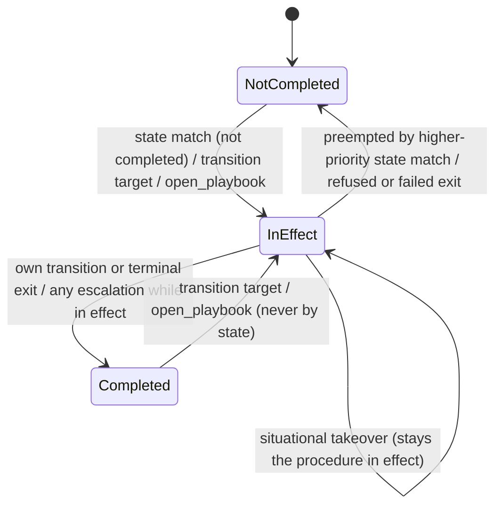

# Data Model: Scout V2 First-Cut Playbooks and Degradation on Missing Capabilities

One migration (one new column). Everything else is either an existing column written by new rules,
an in-memory value, or a playbook file. Research references (§n) point to [research.md](./research.md).

## `ichatr_scout_conversation_states` (existing table — `ScoutConversationState`)

| Column | Status | Rule |
|---|---|---|
| `completed_playbooks` | **NEW** `jsonb`, `default: []`, `null: false` | Procedure names that completed in this conversation (FR-025–FR-028c). Set semantics (a name appears at most once), insertion order kept. Written only together with an exit's routing-state change (below). Never cleared: not by an escalation, not by a hand-back, not by a state activation. Existing rows get `[]` from the column default; no backfill. |
| `unsatisfied_flags` | existing `jsonb`, `default: {}` — **first writer** | The turn's unsatisfied-items record (FR-018), overwritten once per completed model turn (inbox and playground), creating the row when the conversation has none — this supersedes the 085/087 rule that a turn without a successful exit leaves the row untouched or absent. No other column changes with it. Shape below. Not written when the turn never reached the model (quota/API-key fail-safe). |
| `active_playbook`, `activated_at`, `activation_reason`, `last_exit`, `transition_count`, `handoff_limit_reached_at` | existing | Unchanged rules (Brief 02/05/11). |

Migration: `db/migrate/21260928000000_add_completed_playbooks_to_ichatr_scout_conversation_states.rb`
(`add_column … :completed_playbooks, :jsonb, default: [], null: false`), reversible, fork-prefixed
table only (research §1).

### Model operations (`custom/app/models/scout_conversation_state.rb`)

| Operation | Change | Writes (one `update!`) |
|---|---|---|
| `record_transition!(target, turn_transition_count:, completed: nil)` | + `completed:` | success branch: existing columns + `completed_playbooks ∪ [completed]` (unchanged when `completed` is nil). Refused branch (`turn_transition_count >= 2`): **only** `handoff_limit_reached_at`, as today — `completed` ignored. |
| `record_terminal_exit!(exit_name, completed: nil)` | + `completed:` | existing columns (procedure cleared, `last_exit`) + `completed_playbooks ∪ [completed]`. Used by terminal and escalation exits (inbox and playground). |
| `record_unsatisfied_items!(record)` | NEW | `unsatisfied_flags: record`. |
| `record_state_activation!`, `record_trigger_activation!` | unchanged | never touch `completed_playbooks`. |

### Which name is added (FR-026)

Every exit passes `completed: turn_scope.active_procedure_name` — the last procedure in effect in the
turn (pinned at turn start, opened through `open_playbook`, or reached as a transition target;
a situational takeover does not change it). For declared transition/terminal exits this is the
declaring playbook (research §4). `nil` (no procedure in effect) adds nothing.

| Event | Added to `completed_playbooks` |
|---|---|
| Declared terminal exit succeeds | the declaring (in-effect) procedure |
| Declared transition exit succeeds | the source procedure (captured before the target becomes active) |
| Built-in `exit_handoff` (also after a situational takeover) or a procedure's declared escalation succeeds | the last procedure in effect; nothing if none |
| Exit payload invalid, stage checks fail, escalation refused (no longer in the assistant's care), third transition refused | nothing |
| `open_playbook` (procedure or situational), state preemption, state activation | nothing |
| Infrastructure fail-safe (unreadable/empty final output, quota, API key) | nothing — it is not an exit |

## Unsatisfied-items record (`unsatisfied_flags` value and trace metadata)

Built by `Custom::ScoutV2::UnsatisfiedItems.call` when the model turn completes (after `chat.ask`
returns, before the final-reply/fail-safe decision), for `playbook = catalog[turn_scope.active_procedure_name]`.
`UnsatisfiedItems.trace!` builds it and sets the span attribute inside `instrument_agent_session`;
`TurnRunner` persists it (`record_unsatisfied_items!`) after that block returns, so a failing write
cannot re-run the turn ([turn_assembly.md §6](./contracts/turn_assembly.md)).

```json
{ "procedure": "agendamento",
  "pending_fields": [],
  "unmet_requires": ["scheduling", "customer_registry"],
  "unmet_needs": ["politica_reagendamento"] }
```

| Key | Value |
|---|---|
| `procedure` | last procedure in effect, or `null` |
| `pending_fields` | `RoutingSnapshot::PendingFields` recomputed at completion (fresh `reload_active_opportunity`); `[]` when `procedure` is null |
| `unmet_requires` | `playbook.requires − satisfied_capabilities`; `[]` when `procedure` is null |
| `unmet_needs` | `playbook.needs − satisfied_business_facts`; `[]` when `procedure` is null |

Written identically to `unsatisfied_flags` and to the agent-session span as trace metadata
`langfuse.trace.metadata.unsatisfied_flags` (JSON string). The span's `playbook` and
`activation_reason` metadata keep describing the routing decision at turn start; the start-of-turn
`unsatisfied_flags` metadata key is removed (research §7).

## `Custom::ScoutV2::RoutingSnapshot` (in-memory value — extended)

| Member | Status | Source |
|---|---|---|
| `completed_playbooks` | NEW, frozen `Array<String>` | `ScoutConversationState#completed_playbooks` (the builder already loads the row) |
| `satisfied_business_facts` | NEW, frozen `Array<String>` | always `[]` in this feature (FR-019) |
| `satisfied_capabilities` | existing | always `[]` in this feature |
| `pending_fields` | **rule change** | open/any active opportunity: unchanged (scout + stage required keys still blank). **No active opportunity: the scout's qualification requirement keys** (was `[]`) — FR-009b. Extracted to `RoutingSnapshot::PendingFields.call(scout:, opportunity:)`, shared with `UnsatisfiedItems` and `Playbook::ContentBuilder`. |

## State conditions (predicates — `Custom::ScoutV2::Predicates::*`)

Syntax and validation: [contracts/state_conditions.md](./contracts/state_conditions.md).

| Registered name | Argument | Holds when |
|---|---|---|
| `contact_identity_incomplete` | none | `Custom::Scout::ContactIdentityService.placeholder_name?(contact)` or `contact.phone_number.blank?` |
| `contact_has_phone` | none | `contact.phone_number.present?` |
| `opportunity_in_stage` | stage role: `qualified` \| `unqualified` \| `initial` | `ctx.opportunity_stage_role.to_s == arg` (existing builder mapping of the scout's configured stages) |
| `playbook_not_completed` | a procedure playbook name in the catalog (non-empty `when_state`; situational names are rejected at boot) | `arg ∉ ctx.completed_playbooks` |
| `in_qualification` | none | `ctx.opportunity.nil?` or (`OpportunityOpen` and `PendingRequiredFields`) |
| `opportunity_open`, `pending_required_fields` | none | unchanged |

## Catalogs of named requirements

| Catalog | Class | Names | Status |
|---|---|---|---|
| Capabilities | `Custom::ScoutV2::Capabilities::Catalog` (existing) | `scheduling`, `customer_registry` | unchanged |
| Business facts | `Custom::ScoutV2::BusinessFacts::Catalog` (NEW) | `politica_reagendamento` | `known?(name)`, same shape as capabilities |

## Playbook (existing value — no new members)

`requires`/`needs` were already loaded; this feature starts validating `needs` (FR-020) and adds
the **pending-step marker** inside the body: `[[depends: <name>, <name>]]` on a step line, where each
name is one of that playbook's own `requires` or `needs` (contract: [playbook_catalog.md](./contracts/playbook_catalog.md#pending-step-markers)).

## Procedure content (`Custom::ScoutV2::Playbook::ContentBuilder` — new, stateless)

Single renderer for every place a playbook's guidance reaches the model: the pinned playbook in the
system instructions, `open_playbook`'s result (procedure and situational), and a transition's
result. Output = rendered body, then — procedures only, and only when the playbook's `when_state`
reads the fact — the context blocks:

| `when_state` contains | Block appended | Content |
|---|---|---|
| `in_qualification` or `pending_required_fields` | pending fields | existing `PendingFieldsFormatter` over fresh `PendingFields` |
| `contact_identity_incomplete` | missing contact data | NEW `ContactGapsFormatter`: lists `nome` (with "o nome registrado é um identificador gerado pelo sistema — não o use para se dirigir ao cliente") and/or `telefone` |

Rendering of markers, given the turn's satisfaction lists:

- every name satisfied → the marker is removed, the step reads normally;
- otherwise → the marker becomes `(PENDENTE — indisponível: <missing names>)`, and a single
  `PENDING_STEPS_NOTICE` paragraph is appended after the body telling the assistant not to simulate,
  promise or confirm pending actions and to use `exit_handoff` when the customer needs them.

## Turn scope (`Custom::ScoutV2::TurnScope` — existing per-turn object, extended)

| Member | Change |
|---|---|
| `setup_initial_tools!(decision:, ctx:, scout:, conversation:, openable:)` | + `ctx:` — keeps the turn's satisfaction lists for rendering and exit withholding |
| `actions_for(playbook, …)` | declared exits omitted while any `playbook.requires` is unsatisfied (FR-017); tools unchanged |
| `content_for(playbook)` | NEW — `ContentBuilder` with the turn's satisfaction lists; requires the snapshot stored by `setup_initial_tools!` and fails loudly without it |
| `active_procedure_name` | existing; now also the source of the completed name and of the unsatisfied record |

## Lifecycle — procedures in one conversation


